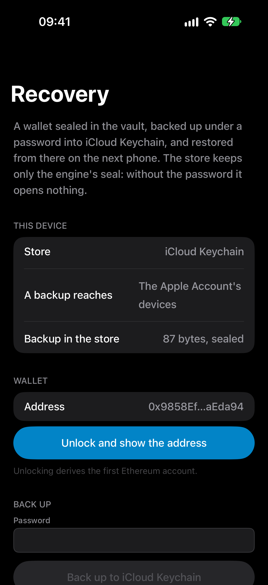
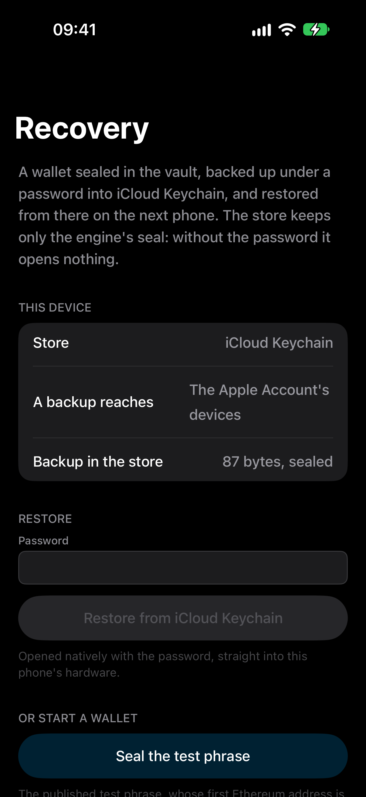
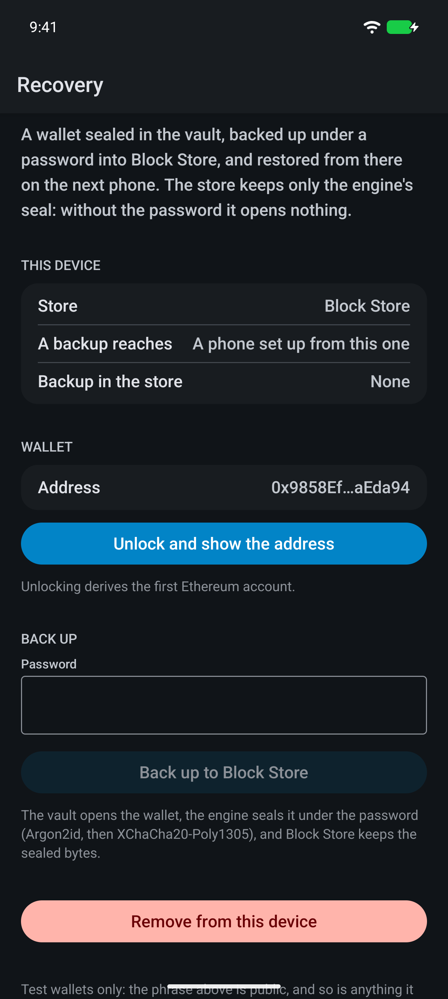

# crypto-recovery

[](https://www.npmjs.com/package/@hzblj/crypto-recovery)
[](./LICENSE)

A wallet's sealed backup kept in iCloud Keychain or Android's Block Store, for React Native and Expo. The
[`@hzblj/crypto-vault`](https://github.com/hzblj/crypto-vault) seals the wallet under a password with the
[`@hzblj/nitro-crypto`](https://github.com/hzblj/nitro-crypto) engine; this package keeps the sealed bytes where the
next phone finds them. The store sees ciphertext, never a password or a secret.

<p>
  
  
  
</p>

```sh
npx expo install @hzblj/crypto-recovery react-native-nitro-modules
```

```ts
import {createRecovery} from '@hzblj/crypto-recovery'

const recovery = createRecovery()

const backup = await vault.backup('main', {password, prompt: 'Back up your wallet'}) // the engine's seal
await recovery.save('main', backup) // iCloud Keychain, or Block Store

// on the next phone
const saved = await recovery.load('main')
if (saved) {
  await vault.restore('main', saved, {password}) // straight into this phone's hardware
}
```

**[Documentation](./packages/crypto-recovery/README.md)**: install, the API, where a backup goes on each platform, and
what is not in this version.

| | iOS | Android |
| --- | --- | --- |
| Store | iCloud Keychain: a synchronizable Keychain item | Block Store (Google Play services) |
| Encryption | End to end, by iCloud Keychain | End to end, where Block Store has it (a screen lock, backup on) |
| Reaches | The Apple Account's devices, as it syncs | A new phone at its setup: from Google's backup, or from this phone |
| Holds | Any number of backups | 16 entries per app |

## This repository

| Path | What lives there |
| --- | --- |
| `packages/crypto-recovery/` | `@hzblj/crypto-recovery`: the spec, the Swift and Kotlin halves, the facade |
| `apps/example/` | The example: a wallet in the vault, backed up into the store, removed, restored from the store |
| `scripts/` | The pack check, version sync |
| `docs/` | [Decisions](./docs/adr) |

```sh
yarn                 # install
yarn test            # the facade's tests
yarn typecheck       # tsc
yarn lint            # Biome
yarn pack:check      # what npm receives, and a consumer type-check
yarn ios             # the example on the iOS simulator (yarn android for Android)
```

[Security](./SECURITY.md) · [MIT](./LICENSE)
